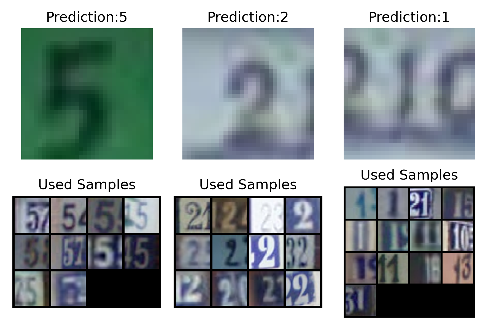
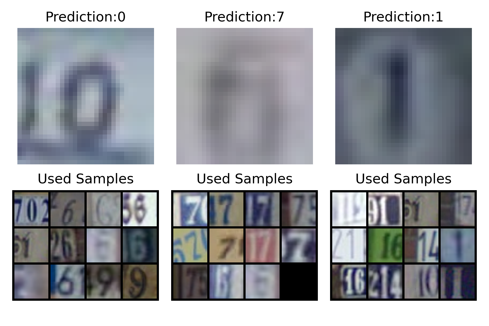
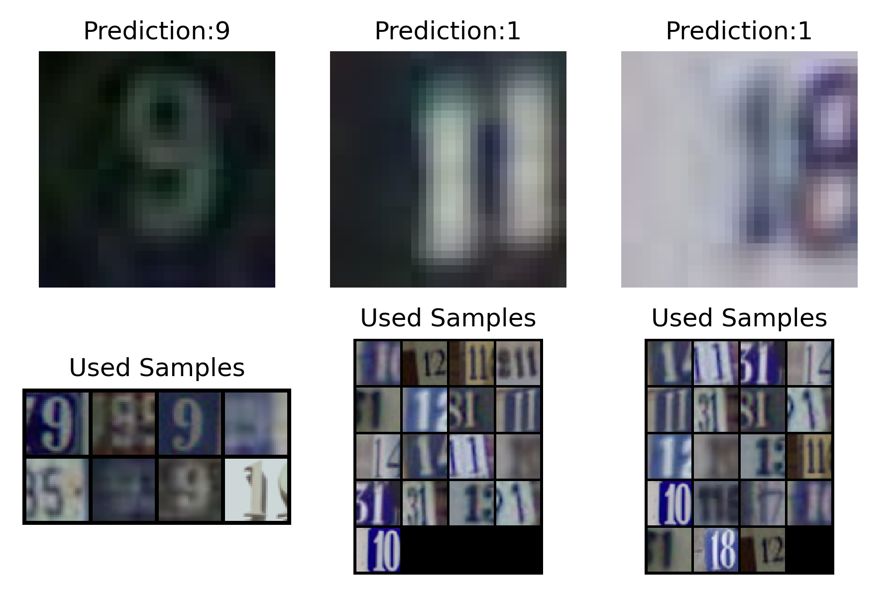

# Task 2 — Project Onboarding: Self-Explainable Deep Neural Networks

**Devansh Patil · CMPM 118 (AIEA Lab auditor)**

## Project choice

I chose the **Self-Explainable Deep Neural Networks (SENN)** project, led by Mattia (Biagio La Rosa). It studies networks that explain their own predictions without external tools. The auditor track focuses on *Memory Wrap*, a layer that classifies an image by comparing it with a small "memory" of training images, so the memories it relies on act as its explanation.

## Task

> Get the reference code repository running locally and generate and visualize the explanation figures (memory images) for the pre-trained model on the test dataset.

## Environment

| | |
|---|---|
| Machine | MacBook (macOS, CPU only — no CUDA) |
| Python | 3.11 in a virtualenv (`--system-site-packages` to reuse the installed PyTorch) |
| PyTorch / torchvision | 2.8.0 / 0.23.0 |
| Extra packages | `memorywrap`, `captum`, `absl-py`, `entmax`, `einops`, `pyyaml`, `scipy` |
| Code | `github.com/KRLGroup/memory-wrap` (the `paper/` directory) |
| Pre-trained model | `paper/models/2000.pt`: Memory Wrap + MobileNet-v2, trained on 2,000 SVHN images, memory set of 100 |

The repo README asks for Python 3.8 / PyTorch 1.9. The code ran unchanged on PyTorch 2.8, apart from harmless deprecation warnings about `torch.cuda.amp` on CPU.

## Steps

```bash
git clone --depth 1 https://github.com/KRLGroup/memory-wrap.git senn
cd senn   # clone of KRLGroup/memory-wrap
python3 -m venv --system-site-packages .venv && source .venv/bin/activate
pip install memorywrap captum absl-py entmax einops pyyaml scipy
cd paper
# (dataset: see "Problems" below)
cd scripts
python ../run_with_local_svhn.py generate_memory_images.py --path_model ../models/2000.pt --max_images 20
```

Figures are saved to `paper/images/mem_images/SVHN/encoder_memory/mobilenet/`.

## Problems I hit and how I fixed them

1. **`ModuleNotFoundError: memorywrap`.** The architectures import the `memorywrap` package, which the paper README lists only as an afterthought. Fixed with `pip install memorywrap`.
2. **SVHN download refused.** torchvision downloads SVHN from `ufldl.stanford.edu`, which returned *connection refused*. The same dataset is mirrored on Hugging Face (`ufldl-stanford/svhn`) as parquet files, so I downloaded those and converted them back to torchvision's `train_32x32.mat` / `test_32x32.mat` format (`parquet_to_mat.py`), relabelling digit 0 as 10 like the original files. The sizes match exactly: **73,257 train / 26,032 test**.
3. **Checksum mismatch.** torchvision rejects any SVHN file whose MD5 differs from the original, and re-encoded files always differ. Instead of editing the lab code, I wrote a small launcher (`run_with_local_svhn.py`) that disables that check and then runs the requested script.
4. **Too many figures.** The script renders one 300-dpi figure for every 3 test images (8,678 figures). I added an optional `--max_images` flag to stop early; the default behaviour is unchanged.

## Results

**Test accuracy of the pre-trained model** (`eval.py`, 5 passes with random memory sets): **80.37%** on the 26,032 SVHN test images (about 26 minutes on my laptop's CPU). The paper reports 81.44 ± 0.76% for this configuration (MobileNet-v2, 2,000 samples), so this single model lands about 1% below the paper's 15-run average. That's plausible for one model evaluated with random memory sets, but I haven't checked further.

**Memory images.** Each figure shows three test images with the predicted class (top) and the memory samples that received a positive attention weight, i.e. the training images the prediction was actually built from (bottom).



*Test images 0–2 (true labels 5, 2, 1, all predicted correctly).* Every used memory sample contains the predicted digit: 5s for the "5", 2s for the "2", 1s for the "1". The model also seems to ignore colour: the green "5" is matched with grey and blue 5s.



*Test images 3–5 (true labels 0, 6, 1; predictions 0, **7**, 1).* The middle image is a very blurry "6" that the model calls a **7**, and its memory set is mostly 7s plus a few blurry, unreadable samples. The memory images make the error easy to diagnose: the model matched the input to other low-quality images instead of to 6s. The "10" on the left is correctly called 0, and its memories are round digits (0, 6, 9, 8), which suggests it focuses on the centred loop shape.



*Test images 6–8 (true labels 9, 1, 1, all correct).* The "9" uses only 8 memory samples, so the sparsemax attention is very selective when the model is confident. The two "1" inputs use about 17–19 samples, nearly all containing a 1, often as part of a multi-digit number like "11" or "31".

## Takeaways

- The explanation comes for free: the memory images are exactly what the final layer used, not an approximation computed afterwards.
- Wrong predictions are visible in the memory images (Figure 2, middle), which is what the next SENN tasks build on: find the model's errors, inspect their memory sets, and try to choose memories that fix them.
