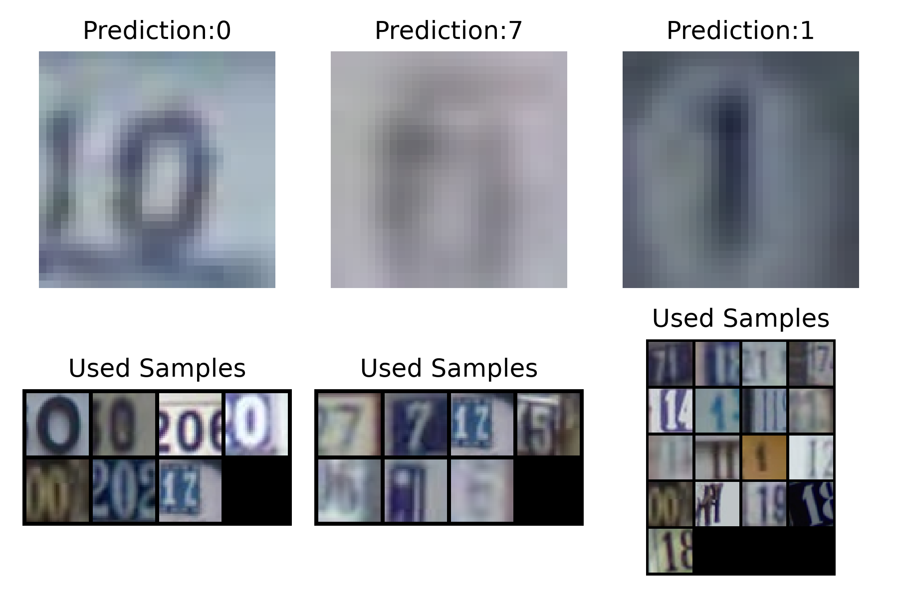

# Task 4 — Running the SENN Reference Code on Nautilus (headless)

**Devansh Patil · CMPM 118 · Project: Self-Explainable Deep Neural Networks**

## Goal

Run the Memory Wrap reference code (`KRLGroup/memory-wrap`) on the Nautilus cluster with no display: load the pre-trained SVHN model, evaluate it, and generate memory-image explanations. Then document the process.

## Setup on my machine

- `kubectl` and `kubelogin` (`kubectl oidc-login`) installed with Homebrew.
- Nautilus config downloaded from nrp.ai → `~/.kube/config` (context `nautilus`).
- Logged in through CILogon with **ORCID** (my NRP account was originally created with ORCID; logging in with the UCSC identity provider gave "Permission denied – authenticate with the source you've previously signed up with").
- `kubectl auth whoami` shows my CILogon user.

## Files (`nautilus/` and `scripts/` in this repo)

| File | Purpose |
|---|---|
| `senn-pvc.yaml` | 2 Gi `rook-ceph-block` volume that caches the SVHN download between runs |
| `senn-job.yaml` | Kubernetes **Job**: CPU only, 4 cores, 8 Gi RAM; requests = limits, as NRP requires |
| `parquet_to_mat.py` | Rebuilds `train_32x32.mat` / `test_32x32.mat` from the Hugging Face SVHN mirror |
| `run_with_local_svhn.py` | Launcher that skips torchvision's MD5 check for the rebuilt files |
| `max_images.patch` | Adds `--max_images` to `generate_memory_images.py` so it doesn't render all 8,678 figures |

### Why the dataset workaround

torchvision downloads SVHN from `ufldl.stanford.edu`, which refused connections when I ran this. The same data is mirrored on Hugging Face (`ufldl-stanford/svhn`, as parquet files). I convert it back to the `.mat` layout torchvision expects. The split sizes match the original exactly (73,257 train / 26,032 test), and digit `0` is relabelled to `10` as in the original files. Because the re-encoded files have different MD5 checksums, the launcher disables torchvision's integrity check.

## Steps

1. Create the scripts ConfigMap and the volume, then start the job:
   ```bash
   kubectl create configmap senn-scripts -n aiea-auditors \
     --from-file=scripts/parquet_to_mat.py --from-file=scripts/run_with_local_svhn.py --from-file=scripts/max_images.patch
   kubectl apply -n aiea-auditors -f nautilus/senn-pvc.yaml
   kubectl apply -n aiea-auditors -f nautilus/senn-job.yaml
   ```
2. Follow the logs: `kubectl logs -n aiea-auditors -f job/dvpatil-senn-task4`
3. Copy the figures out during the 15-minute window at the end:
   `kubectl get pods -n aiea-auditors` → `kubectl cp aiea-auditors/<pod>:/results ./nautilus-results`
4. **Clean up** (lab and NRP policy: don't leave idle resources):
   `kubectl delete -n aiea-auditors job/dvpatil-senn-task4 configmap/senn-scripts pvc/dvpatil-senn`

## What the job does

1. Installs `git` and the Python dependencies (`memorywrap`, `captum`, `absl-py`, `entmax`, `einops`, `pyyaml`, `scipy`, `pyarrow`, `matplotlib`) on top of the `pytorch/pytorch:2.4.1` image.
2. Clones `memory-wrap` and applies the `max_images` patch.
3. Downloads SVHN into the volume (skipped if already cached) and converts it.
4. Runs `eval.py` on `models/2000.pt` and prints the test accuracy.
5. Runs `generate_memory_images.py --max_images 20` and copies the figures to `/results`.

## Results

| | |
|---|---|
| Date | Oct 26, 2026 (pod started 06:41 UTC Oct 27) |
| Pod / node | `dvpatil-senn-task4-tb5cw` on `nautilus-it-gpu07.fullerton.edu` |
| Resources actually used | ~1.3 CPU cores, ~790 MiB RAM (of 4 CPU / 8 Gi requested) |
| Test accuracy (pre-trained model, 26,032 SVHN test images) | **80.37%**, identical to my local run |
| Evaluation time | **10.2 min** on Nautilus vs. about 26 min on my laptop |
| Figures generated | 20 (60 test images), copied back with `kubectl cp` |
| Cleanup | Job, ConfigMap and PVC deleted right after copying the results |

The accuracy matches my local run exactly because `eval.py` fixes the random seed. The memory-image figures are *not* identical: each figure draws a new random memory set, so different training samples appear in the "Used Samples" grids. The predictions stayed the same, including the same mistake.



*Test images 3–5 from the Nautilus run (true labels 0, 6, 1).* The blurry "6" is again predicted as **7**. This time its used memory samples are mostly 7s plus a few unreadable images, a different set from my local run but the same failure. That suggests the error comes from the input image itself, not from an unlucky memory draw, which is directly relevant to the later SENN tasks about correcting wrong predictions by changing the memory set.

All 20 figures are in `figures/nautilus/`.

## Problems and notes

- **First run failed.** The job crashed at the evaluation step with `ModuleNotFoundError: No module named 'utils'`. My launcher script ran `eval.py` with `runpy`, which (unlike `python eval.py`) doesn't put the script's folder on Python's import path. On my laptop the launcher happened to sit in that folder, so I didn't notice. Fix: the launcher now inserts the script's directory into `sys.path`. I updated the ConfigMap, deleted the failed Job and re-applied it. The dataset was already cached on the PVC, so the re-run went straight to setup and evaluation.
- **Login identity mismatch**, explained above. Fixed by using ORCID.
- **SVHN download server unreachable**: fixed with the Hugging Face mirror.
- Kept resources small (CPU only) because the pre-trained model only needs inference; a GPU would sit idle, and the lab asks us not to under-use requested resources. Even so, the job used only about a third of its 4 requested cores, so 2 cores would have been enough.
